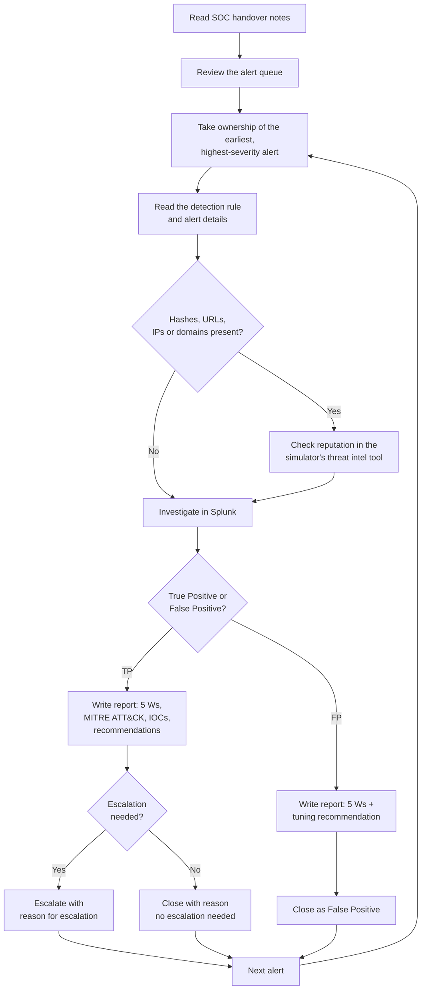

# TryHackMe SOC Simulator Writeups

Writeups from the [TryHackMe SOC Simulator](https://tryhackme.com/soc-sim), where I work simulated SOC shifts as an L1 analyst: triaging a live alert queue, investigating in a SIEM, classifying alerts as true or false positives, and writing case reports for escalation.

Each scenario folder documents the attack chain, how I triaged every alert type, my results, and what I'd do to improve as a SOC analyst in the future.

---

## My Triage Approach

I follow the same workflow in every scenario, so my investigations stay consistent and my reports are comparable across runs.

### 1. Read the SOC handover notes
Handover notes provide business context that decides whether activity is normal, such as a marketing campaign that explains a flood of themed emails, or a reminder to update closed reports when they turn out to be linked to a later incident.

### 2. Review the alert queue
I scan the queue for patterns: repeated rule names, repeated hosts, and clusters of alerts in a short time window.

### 3. Take ownership of the earliest, highest-severity alert
Working oldest-first within severity preserves the attack timeline, so early-stage activity (delivery, execution) is understood before later stages (collection, exfiltration).

### 4. Read the detection rule and alert details
I compare what the rule is looking for against what actually triggered it: process and parent names, command line, file path, sender and recipient, attachment.

### 5. Check threat intelligence
If the alert contains hashes, URLs, IPs, or domains, I check their reputation in the simulator's threat intel tool before going further.

### 6. Investigate in Splunk
- **Baseline:** does this behavior happen on other hosts, or repeatedly on this one?
- **Host timeline:** what else happened on the host before and after the alert?
- **Pivot:** follow the user, host, process ID, or sender into related events.

### 7. Write the case report
Every report is written so that an analyst who has never seen the alert can understand it:

| Section | Content |
|---|---|
| **Who** | Users, accounts, processes, senders/recipients involved |
| **What** | What happened, in technical detail |
| **When** | Timestamps, plus where the event sits in the attack timeline |
| **Where** | Hosts, file paths, shares, external domains |
| **Why** | Evidence behind the verdict, linking related alerts |
| **MITRE ATT&CK** | Technique mapping for true positives |
| **IOCs** | Indicators to block or hunt for |
| **Conclusion** | True Positive / False Positive |
| **Escalation** | Escalate or not, with the reason, based on impact and scope |
| **Recommendations** | Containment steps for TPs, detection tuning for FPs |

### 8. Decide on escalation
Not every true positive needs escalation. I escalate when the activity shows real impact or risk: confirmed compromise, attacker control of a host, access to sensitive data, or exfiltration. A true positive with no impact (for example, a blocked attempt) can be closed with a documented reason. False positives are closed with a detection tuning recommendation.

---

## Scenarios

| Scenario | Difficulty | Alerts | TP / FP (actual) | My Accuracy | Writeup |
|---|---|---|---|---|---|
| Phishing Unfolding | Medium | 36 | 15 / 21 | 32/36 correct | [Read](scenarios/phishing-unfolding/phishing-unfolding-writup.md) |

---

## Tools & Skills
**SIEM:** Splunk (SPL) · **Telemetry:** Sysmon, email logs · **Frameworks:** MITRE ATT&CK · **Skills:** alert triage, log analysis, attack chain reconstruction, Base64/DNS exfiltration analysis, incident reporting

## About Me
- **BS Computer Science (Cybersecurity concentration)**, University of Delaware
- **CompTIA Security+**
- **TryHackMe Security Analyst Level 1 (SAL1)**, professional certification
- **TryHackMe SOC Level 1**, training path